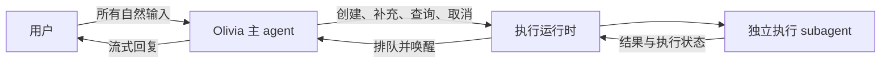
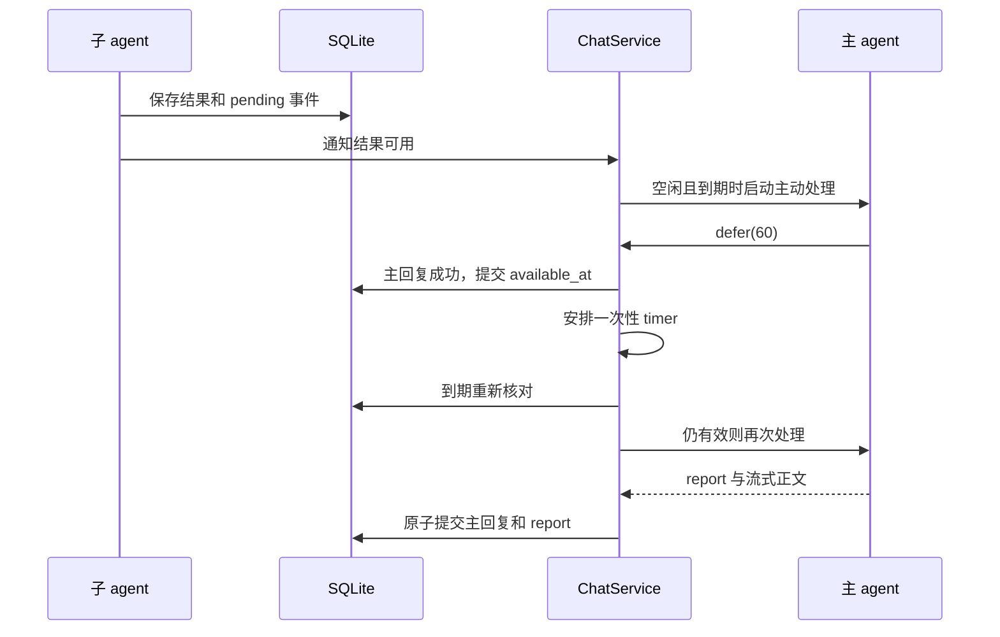

# Agent 架构

Olivia 由一个持续对话的主 agent 协调独立的后台执行上下文。用户始终与同一个角色交流，所有输入通过 `chat/send({text})` 到达；主 agent 理解话语与已有工作的关系，运行时负责执行、持久化和调度。

本文解释架构选择、职责与并发语义。模块及 UI 集成见 [后端与 UI](AGENT_BACKEND.md)，存储和上下文契约见 [历史与记忆](HISTORY_MEMORY.md)，前端接口见 [通信协议](CHAT_PROTOCOL.md)。

## 设计目标

用户可以在委托工作后继续聊天，也可以自然地补充或撤回委托。例如：

> “帮我整理今天的会议。” → Olivia 受理，后台开始执行。
>
> “今天真的累死了。” → Olivia 接住聊天，整理仍继续。
>
> “产品那场别算了。” → Olivia 将补充交给原工作。
>
> “算了，刚才的别弄了。” → Olivia 确定所指并停止相应工作。

工作完成后，Olivia 可以主动接回结果。一次回复结束只代表一句话说完，不代表对话关系或用户委托结束。

由此得到三个系统边界：

- **语义判断属于主 agent。** 前端不识别任务归属，运行时不靠关键词选择补充或取消目标。
- **对话与执行有独立生命周期。** 换话题、替换前台草稿或隐藏气泡不隐式取消工作。
- **对外只有一个发言主体。** 子 agent 返回执行结果，由 Olivia 决定如何、何时表达。

## 架构取舍

Agent loop 描述模型如何调用工具并继续推理；异步能力取决于调度和上下文边界。单一 agent 同样可以等待后台工具、接受新输入并被完成事件唤醒。选择独立执行上下文，是为了让多步工作在聊天转向后仍有自己的目标、资料和执行进度。

| 方案 | 适用点 | 代价或限制 |
| --- | --- | --- |
| 对话和工作共用一个串行 loop | 结构简单，上下文无需交接 | 长工具和持续推理与聊天争用同一执行过程 |
| 对话 loop 加异步普通工具 | 适合确定性操作，工具等待可让出执行机会 | 多步自主工作仍需管理独立进度和后续调用 |
| 用户手动维护多个工作对话 | 用户可以明确选择目标与资料 | 分发、切换和搬运上下文的负担落在用户身上 |
| 对话 agent 协调独立执行上下文 | 聊天与工作分别推进，统一角色和结果出口 | 需要处理交接损失、过期轮次、去重和事件调度 |

Olivia 采用最后一种结构。主 agent 默认关闭深度思考以缩短接话路径，子 agent 开启思考完成复杂工作。委派和转述会增加模型调用，独立上下文也可能丢失交接信息；响应、质量和成本需要同时评估，不能只用一句快速的“收到”证明架构有效。

后台业务使用单个执行槽，多项工作排队。前台请求和记忆加工不占这个槽。主子 agent 可以共享模型适配器和进程，逻辑隔离不要求不同模型或 OS 进程。

## 组件职责

Harness 是围绕模型的上下文、执行循环、工具、生命周期和持久化机制的整体。代码将这些职责分别放在以下组件中：

| 组件 | 职责 |
| --- | --- |
| `ChatService` | 受理文字、维护前台 turn 与草稿、安排结果唤醒、发出流式展示通知 |
| `AgentLoop` | 在固定 agent 和 turn 内调用模型、转发正文、分派工具并继续循环，退出过期轮次 |
| `ContextProvider` | 组装消息、工具定义、记忆和运行事实，检查整体输入容量 |
| `agent_tools` / `AgentRuntime` | 统一工具定义与参数校验；执行控制、去重、子 agent 调度和结果处理 |
| `HistoryStore` | 保存原始消息与执行事实，提供事务和内存读取视图 |
| `MemoryStore` / `MemoryCompiler` | 读取与发布记忆快照；异步提炼主对话并维护页面和索引 |
| 模型适配器 | 将模型上下文转换为请求，解析流式正文、工具调用和用量 |

ContextProvider 从 Runtime 获取只读状态，从统一工具定义获取 schema；Runtime 用相同定义校验执行。模型适配器不依赖存储结构，UI 只接收展示信号。组件之间的调用关系见 [模块与数据流](AGENT_BACKEND.md#模块与数据流)。

## 对话与执行的协作

### 语义判断与控制工具

主 agent 根据当前话语、相关历史和在办事项决定动作。同一句话可以同时包含闲聊和工作要求；生成期间到来的话语也不必属于当前工作。

| 工具 | 主 agent 决定什么 | 运行时保证什么 |
| --- | --- | --- |
| `create_subagent` | 目标、资料与授权范围 | 持久化受理后返回，独立启动或排队 |
| `steer_subagent` | 补充属于哪项工作、新要求是什么 | 保留目标与历史，推进目标 turn，使旧执行失效 |
| `stop_subagent` | 撤回的目标和范围 | 禁止后续步骤，停止可中断执行，返回真实状态 |
| `get_subagent` | 是否需要核对进度和证据 | 返回全部已存子历史及在途调用，不改变执行状态 |
| `handle_subagent_results` | 现在转述、暂缓或停止主动报告 | 记录决定并在主回复成功提交时应用 |

这些是后端内部工具，不是前端 RPC。目标不明确时，由主 agent 自然澄清；运行时不猜测，也不默认取消全部工作。

子 agent 使用 read_file、write_file 和可配置的 run_shell 完成业务。确定性异步工具可以作为另一条执行路径，但尚无独立提交入口；本地工具通过子 agent loop 执行。运行时不展开递归委派。

### 上下文交接

主 agent 交接目标、相关原话、明确约束、必要偏好、资源引用、授权范围和预期产物。不能把“先写草稿，别发送”压缩成“处理邮件”。子 agent 保留自己的执行资料，日常聊天不自动进入其上下文。

子结果应区分结论、依据、产物、实际完成动作和未完成事项。主 agent 可以按需查询完整历史，核对后再转述。子 agent 没有直接输出到 UI 的通道。

### 补充与取消

补充受理后，目标子 agent 的 turn 递增，旧草稿失效；停止旧执行后以新约束继续。已执行的动作保留，执行模型应先核对再继续；运行时按[稳定操作键](HISTORY_MEMORY.md#操作凭据与未知结果)拒绝重复执行。

取消排队工作会直接结束排队；取消运行中的工作先进入 cancelling，协程与进程组停止后才进入 cancelled。取消不推进 turn，也不回滚已发生的外部动作。对已完成工作，撤回只抑制尚未报告的结果，不改写完成事实。

“已受理取消”与“工作已停止”是不同状态。不能立即中断的操作需要等待或核对实际结果，主 agent 必须依据运行状态说明情况。

## 处理轮次与过期隔离

`turn` 表示一个 agent 已受理的处理轮次，由 `(agent_id, turn)` 标识。它不是消息数量或模型调用次数，一轮可以包含多个模型请求和工具调用。主子 agent 的计数独立，重启后保留。

| 事件 | 主 turn | 子 turn |
| --- | --- | --- |
| 有效用户输入 | +1；替换未完成的前台草稿 | 不变 |
| 前台空闲且存在到期结果，启动主动处理 | +1 | 不变 |
| 创建或补充子工作 | 不变 | 目标 +1，排队时即生效 |
| 排队工作取得执行槽 | 不变 | 沿用受理时的值 |
| 停止子工作 | 不变 | 不变，通过状态禁止继续 |
| 工具返回、回复完成、结果入库、timer 重排、记忆发布 | 不变 | 不变 |

新用户输入先在事务中保存原话、推进 turn 并将旧草稿标记 superseded，再取消旧请求。AgentLoop 在模型请求、流片段和工具执行入口核对轮次及 running 状态；最终提交还核对消息 ID 和 streaming 状态。

过期轮次失去继续输出和开始新动作的资格，不自行重新启动。已受理的委派与已经发生的文件操作保留；迟到的工具返回仍可归原 turn 保存为执行事实，但不继续下一步。操作稳定键不包含 turn，因此重生成不会改变同一动作的去重身份。

用户输入与回复完成同时到达时，backend 按实际接收状态处理。前端不参与轮次选择，也不因上次回复刚完成而要求用户重发。持久化约束见 [原始历史的数据模型](HISTORY_MEMORY.md#原始历史的数据模型)。

## 结果投递与唤醒

结果正文属于子 agent 的历史，投递状态属于 `result_events`。子工作完成时，两者原子保存；前台空闲时唤醒主 agent，忙碌时保留事件。完成结果不会直接覆盖对话或展示工具日志。

### 投递决定

| 动作 | 成功提交后的效果 |
| --- | --- |
| `report` | 标记已通过该主回复转述，不再主动投递 |
| `defer` | 保持 pending，将下次检查时间设为提交时刻加 delay_seconds |
| `suppress` | 停止主动报告，原文仍可查询 |

主 agent 只能处理上下文中实际看到的有效结果。决定先暂存在当前主 turn，等主回复成功时与正文一起提交，并再次核对来源子 turn 和状态。回复失败、被替换或进程退出都不会应用未提交决定。

defer 的延迟为 1–300 秒，report 和 suppress 可以填 0。主动处理允许仅 defer 或 suppress 而不输出正文，此时不创建空文字流。重复 defer 没有累计最长时限。

### 单一 Timer

Timer 是可以取消和重建的唤醒预约；pending 事件才是尚待处理的结果。每个主 agent 至多持有一个 `TimerHandle`，不为每项子工作建立独立 timer。

`schedule_results()` 先清理旧 handle，再按有效 pending 事件计算最早检查时间。前台正在受理输入或生成时不创建 timer，当前轮结束后再安排。有效事件要求来源 turn 仍匹配，且来源不处于 cancelling。

到期回调清空 handle 并重新查状态：没有到期结果则退出或重排；前台忙则保留事件；前台空闲且仍有到期结果，才推进主 turn 并调用模型。模型看到 `turn_trigger=subagent_results`，结合最新对话决定转述或再次暂缓。等待期间没有模型轮询。

### 新输入与结果竞争

有效输入到达时，ChatService 先取消物理 timer，再受理用户话语。pending 事件及原期限保留，主 agent 的上下文仍包含未到期结果，因此可以回答用户提前发起的进展询问。

| 情况 | 处理方式 |
| --- | --- |
| 用户只是闲聊 | 未处理结果保持 pending；回复结束后按原期限重排 |
| 主 agent 查询子历史但未选择投递动作 | 查询不消费事件 |
| 只报告部分结果 | 为剩余事件重新安排 timer |
| report 决定后回复失败或被替换 | 决定丢弃，事件继续 pending |
| 输入先于到期回调受理 | 回调看到前台忙碌，不另开一轮 |
| timer 已启动主动回复后用户开口 | 用户开启新主 turn，替换主动草稿；未提交结果仍可处理 |
| 子工作被补充或撤回 | 旧结果失效，不再主动投递 |
| 输入参数无效 | 拒绝请求，不取消既有 timer |

已到期却未被处理的结果，在主回复成功后间隔 30 秒重试，回复失败后间隔 60 秒重试。这是运行时退避，与模型明确 defer 不同；不能因此拖后另一条尚未到期但更早可检查的结果。timer 最小间隔为 50 ms，避免同步反复唤醒。

### 恢复与展示语义

`available_at` 持久化为墙上时间，TimerHandle 只存在于进程内。启动后从 pending 事件重建预约，退出期间不调用模型。休眠和系统调时会影响实际唤醒时刻，不提供严格实时保证。

report 表示对应主回复已经成功持久化，不表示用户已经看见。数据库提交和 UI 展示没有跨进程事务，也没有已读确认；被打断的片段可能已经显示，后续转述不构成严格的“只看见一次”。气泡关闭和阅读行为见 [展示行为](AGENT_BACKEND.md#展示行为)。

## 记忆与持续对话

主对话通过高频记忆、Markdown 索引与页面、原始历史三层资料保持连续性。默认提供高频记忆和入口索引，需要细节时由主 agent 调用工具读取页面或原文。

MemoryCompiler 异步加工近期保护窗口之外的主对话，不占业务槽、不产生对外发言。加工进度落后但上下文仍容得下时，聊天继续；上下文放不下且有可加工的旧对话时，允许等待加工。近期原文的保护规则见 [历史与记忆](HISTORY_MEMORY.md#容量与历史选择)。等待只暂停模型请求，新的输入仍可受理并持久化，旧前台等待者取消也不取消共享加工。

原始记录始终留底。纠正和遗忘改变后续使用约定，过期批次不能恢复已停用内容。具体接口与一致性规则见 [历史与记忆](HISTORY_MEMORY.md)。

## 执行与故障边界

文件操作在线程中运行；关闭或取消时等待在途文件调用结束。shell 使用独立进程组，超时或取消时终止该组。任意命令可能自行脱离进程组，这不是系统级进程监管或 OS 沙箱。

文件工具限制解析后的路径位于 workspace；shell 使用当前用户权限，workspace 不是权限边界。工具调用前保存凭据，执行后保存实际返回；跨进程崩溃时可能留下结果未知的动作，需要先核对，不能自动重做。详细规则见 [操作凭据与未知结果](HISTORY_MEMORY.md#操作凭据与未知结果)。

启动恢复将遗留执行标记 interrupted，保留 turn 与历史，为需要报告的中断创建结果事件，不自动续跑。关闭桌宠会关闭 backend，没有独立 daemon。

架构的有效性需结合连续输入、补充与撤回、结果回流及长期记忆质量评估。可复现测试与尚未量化的范围见 [运行与验证](CHAT_TESTING.md#验证覆盖与边界)。
