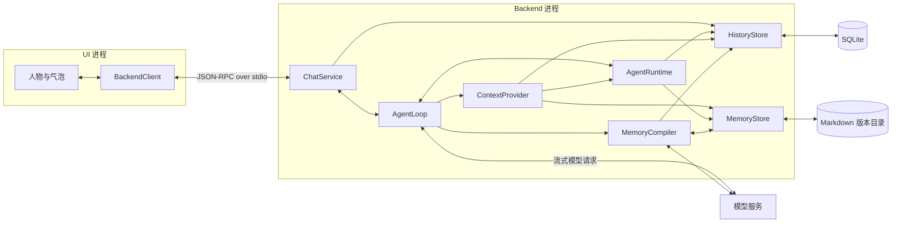

# 后端与 UI

桌宠由 PyQt UI 和本地 Python backend 两个进程组成。UI 发送用户的话语并展示流式回复；backend 维护 Olivia 的持续对话、后台执行、历史和记忆。

本文说明模块如何连接、请求如何流转以及 UI 如何呈现结果。架构取舍见 [Agent 架构](AGENT_ARCHITECTURE.md)，协议字段见 [通信协议](CHAT_PROTOCOL.md)，数据契约见 [历史与记忆](HISTORY_MEMORY.md)。

## 模块与数据流

| 文件 | 主要职责 |
| --- | --- |
| `pet.py`、`speech_bubble.py` | 用户输入、人物表现、气泡排版、滚动和可见性 |
| `backend_client.py` | QProcess 管理、请求与通知解析、Qt 信号 |
| `backend/__main__.py` | 配置加载、组件组装、JSONL 接入和退出清理 |
| `backend/service.py` | 输入受理、主 turn 与草稿、结果 timer、流式展示通知 |
| `backend/harness.py` | AgentLoop 模型/工具循环、Ark SSE 适配与测试模型 |
| `backend/context.py` | 统一组装消息、工具和运行资料，检查整体预算 |
| `backend/runtime.py` | 子 agent 执行槽、工具分派、取消、去重和结果决定 |
| `backend/agent_tools.py` | 工具定义、参数校验和角色使用规则 |
| `backend/local_tools.py` | 异步文件操作、shell 进程组、超时和输出限制 |
| `backend/storage.py` | SQLite 事务、消息内存视图、检查点与恢复 |
| `backend/memory.py` | 记忆快照、受限读取、文件校验和完整版本发布 |
| `backend/memory_worker.py`、`prompts/memory_compiler.md` | 主对话加工调度、发布校验与知识维护规则 |
| `backend/config.py`、`prompts/olivia.md` | 本地配置与角色提示词 |

后端模块通过普通接口协作，只有 UI 与 backend 之间跨进程通信。SQLite 和记忆目录都是本地存储，不是独立服务。

## 对话请求路径

1. BackendClient 将 `chat/send({text})` 写入 backend 的 stdin。
2. ChatService 保存用户原话、分配主 turn 和草稿，替换过期草稿，然后返回受理响应。
3. AgentLoop 从 ContextProvider 获取完整的 messages 和 tools，调用模型适配器。
4. ArkModel 持续解析上游 SSE；每段正文立即通过 `chat/delta` 返回 UI，不等待全文完成。
5. 模型请求工具时，AgentLoop 将调用交给 Runtime。Runtime 校验、保存调用和结果，后续模型请求通过 ContextProvider 看到工具返回。
6. 回复结束后，ChatService 校验当前 turn，保存正文和有效结果决定，发送完成通知并重排结果 timer。

循环等待模型、工具或记忆加工时，事件循环仍可受理输入。是否创建、补充或取消工作由主 agent 决定；替换前台草稿不会自动停止业务子 agent。轮次竞争和结果唤醒规则见 [Agent 架构](AGENT_ARCHITECTURE.md)。

前端只用 messageId 关联正在显示的文字，不接收或发送 agent ID、turn 或执行控制信息。受理响应和一条文字流结束都不是用户任务边界。

## 历史与记忆集成

HistoryStore 在启动恢复后加载原始消息，事务提交时增量更新内存视图。MemoryStore 加载已发布的记忆版本，ContextProvider 从这两个 Store 读取资料，不维护另一份需要调用方刷新的历史缓存。

MemoryCompiler 在有待处理主对话时安排异步加工。正常加工与聊天、业务执行独立进行；上下文放不下未加工内容时，AgentLoop 才等待加工再重建。MemoryStore 完整发布文件后切换内存快照，主 agent 可以通过 read_memory 和 read_raw 进一步查阅。

原始历史、记忆页面、加工状态的归属和事务边界统一定义在 [历史与记忆](HISTORY_MEMORY.md)。

## 模型适配与配置

ArkModel 使用 OpenAI Python SDK 的 AsyncOpenAI 调用方舟 Chat Completions。适配器接收模型消息、工具 schema 和调用设置，返回流式正文、工具调用及用量，不依赖 agent 存储或 UI。

正文逐段转发，tool_calls 参数在流中聚合完整后再执行；工具返回使用 tool_call_id 配对。模型调用失败以受控错误反馈，凭据和完整服务响应不进入前端错误消息。

主 agent 使用 `thinking.type=disabled`；业务子 agent 和记忆加工使用 enabled。角色提示独立保存在 `prompts/olivia.md`，人物设定的来源见 [PERSONA.md](PERSONA.md)。

API key、base URL 和 model / endpoint 统一读取被 Git 忽略的本地配置，支持对应环境变量覆盖。缺少必填项时不回退到默认服务。配置字段、默认值和运行命令见 [运行与验证](CHAT_TESTING.md#配置和启动)。

## 展示行为

### 气泡布局

气泡是人物窗口拥有的 Qt 工具窗口，位于头部旁边，随人物移动并在屏幕边缘调整方向。人物窗口保持原有 450 × 620 几何和素材。

气泡采用圆润的椭圆轮廓和漫画尖角，从紧凑的 140 × 88 起随文字增长，最大为 360 × 320；达到上限后才滚动。正文居中布局，支持选择和复制，向上阅读时不强制滚到底部。等待时显示轻微跳动的省略号，不显示执行状态标题。

### 可见性与阅读

气泡没有关闭叉号、按钮或任务控制入口。右键菜单的“关闭对话 / 展开对话”和卡片“对话”入口控制同一可见状态；关闭只隐藏内容，后台输出和持久化继续。

回复完成后默认闲置 30 秒收起，可通过 bubble_seconds 调整。鼠标悬停、焦点、选中文字、向上阅读、生成中或人物隐藏时暂停自动收起。

| 场景 | UI 行为 |
| --- | --- |
| 回复期间继续输入 | 输入保持可用；新消息开始时切换显示对象，过滤旧消息的迟到片段 |
| 用户主动关闭气泡 | 后台结果不重新打开；展开时可查看最新有效回复 |
| 人物隐藏或最小化 | 结果不强行显示人物 |
| 用户正在阅读旧内容 | 新文字暂存，阅读结束后再展示 |
| 正常自动收起后到达主动回复 | 人物可见时允许显示新回复 |
| 模型失败或中断 | 气泡保留已有文字，卡片显示错误；无正文时气泡展示错误说明 |
| 输入受理失败 | 恢复输入草稿；用户可以编辑后重试 |

主动生成、回复持久化和用户看见内容是三个不同事件。UI 可见性不会改变业务执行或结果投递状态，backend 也不把 report 当作已读确认。

## 进程生命周期

UI 使用当前 Python 解释器启动 `python -u -m backend`，无需单独启动服务。backend 完成配置和存储初始化后发送 ready 通知，再恢复待处理结果与记忆加工调度。

隐藏到托盘不退出 backend。彻底退出时，UI 关闭 stdin，backend 取消生成与子执行、保存中断状态并结束记忆维护；未及时退出时 UI 依次终止和强制结束进程。后台异常退出后 UI 结束等待，允许用户手动重新连接，不自动重发已经发送的输入。

同一数据库通过文件锁限制为一个 backend 写入。第二个实例不能同时使用该历史库，测试必须指定临时数据库。启动恢复、未知外部动作与备份规则见 [存储事务与恢复](HISTORY_MEMORY.md#存储事务与恢复)。
