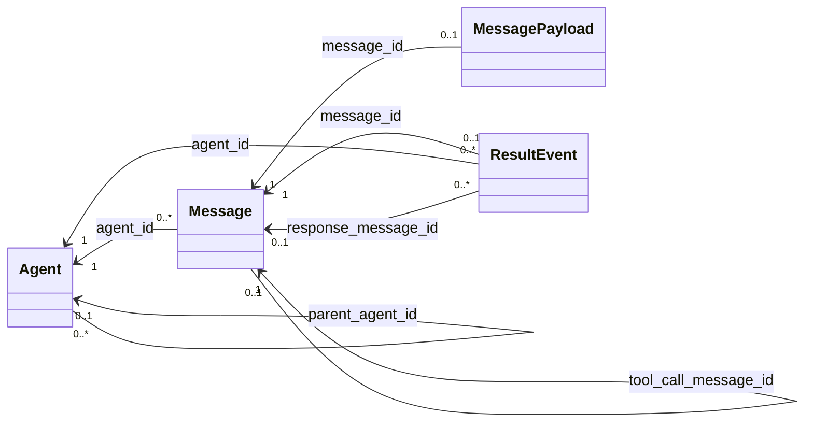

# 历史与记忆

Olivia 的历史记录保存发生过的对话和执行事实；记忆从主对话中提炼可长期使用的信息，并保留到原文的引用。两者共同支持持续交流：近期内容直接进入上下文，较早的内容通过索引按需读取，原始记录始终留底。

本文定义记忆的数据模型、上下文接口和持久化规则。对话与执行的调度见 [Agent 架构](AGENT_ARCHITECTURE.md)，模块连接见 [后端与 UI](AGENT_BACKEND.md)，配置及验证方法见 [运行与验证](CHAT_TESTING.md)。

## 三层记忆

| 层次 | 保存什么 | 如何进入上下文 |
| --- | --- | --- |
| 高频记忆 | 用户偏好、重要约定和必要的近期状态 | `hot.md` 随每次主对话请求提供 |
| 记忆索引与页面 | 主题、人物、事件的归纳，以及关联和来源 | 默认提供根 `index.md`；模型沿链接按需展开 |
| 原始消息（raw） | 用户原话、助手回复、工具调用与返回、草稿状态 | 近期及未加工的有效主对话直接提供；较早原文按消息 ID 读取 |

索引和内容页使用 Markdown。页面既可以属于某个目录，也可以链接其他主题，形成可交叉导航的知识网络。高频记忆是这些页面的精选，更新页面时需要一起核对，避免默认上下文仍携带旧结论。

原文保存在 SQLite，记忆加工、上下文裁剪和用户要求“忘掉”都不删除它。加工进度回答“哪些原文已经处理”，上下文窗口回答“这次模型需要看到什么”，两者独立：已加工的近期对话仍可直接携带，未加工的有效对话必须保留在上下文中。

### 提炼范围与事实来源

加工材料是主 agent 的用户消息和已完成的普通回复。子 agent 历史、工具调用及工具返回不直接作为新的对话事实提炼；后台结果经主 agent 带回对话后，可以作为助手陈述参与加工。加工器可以按需核对主对话中的原文和工具记录。

页面应区分用户陈述、助手推断和执行结果，记录时间条件与替代关系。失败、被替换或中断的草稿仅供审计；召回的旧记忆也不能被重新记成用户刚刚确认的事实。程序验证来源引用与文件结构，事实归纳的准确性仍取决于模型。

## 记忆文件与来源引用

记忆目录位于数据库旁，名称为 `<数据库文件名>.memory/`。高频记忆、索引、页面和加工状态作为完整版本发布：

```text
chat.sqlite3
chat.sqlite3.memory/
├── CURRENT                       当前版本标识
└── versions/
    └── <version>/
        ├── hot.md                高频记忆
        ├── index.md              根索引
        ├── policies.md           用户明确的纠正与停用约定
        ├── log.md                程序维护的近期加工回执
        ├── topics/
        │   ├── index.md          可选的下一级索引
        │   └── work.md           主题内容
        ├── people/
        │   └── user.md           用户长期偏好与约定
        ├── events/
        │   └── review.md         有时间范围的事件
        └── .state.json           程序维护的来源、进度与校验信息
```

默认按 people、topics、events 组织人物、持续主题和有时间范围的事件，用户长期偏好归入 people/user.md。有明确时间、用途和参与者的会议、评审等安排使用独立事件页，主题和人物页链接到它。上述分类是加工提示词的组织约定，不是程序按关键词分类；已有合适页面优先沿用，也允许按内容扩展目录。路径表示稳定对象，新增消息、人物别名或事件改期不应自动产生另一份页面。

索引项包含标题、简述和页面链接；索引变长时可以拆分下一级索引。所有内容页必须从根索引可达，允许跨目录链接和环状关联。例如项目页链接负责人，人物页链接参与的项目，链接旁说明两者的关系。

普通相对 Markdown 链接指向其他页面，`raw:message/<message_id>` 指向 SQLite 中的一条原始消息。例如：

```markdown
用户希望技术讨论先明确边界，再展开实现。

- 关联：[项目协作](../topics/collaboration.md)
- 来源：[用户原话](raw:message/0123456789abcdef0123456789abcdef)
```

内容页必须有来源引用；读取工具按 ID 返回原始消息的角色、时间、状态和已有的工具 payload。需要多条语境时显式读取多个 ID。模型不会获得数据库路径或任意 SQL 接口。

`.state.json` 保存数据库绑定、已处理消息指纹、允许来源、停用 ID、约定和文件校验和。它与 `policies.md`、`log.md` 由程序维护；加工模型可以编辑高频记忆、索引和内容页，不直接修改加工状态或用户约定。版本目录由 MemoryStore 管理，直接修改已发布文件会导致校验失败。

## 上下文组装

`ContextProvider` 将对话所需的信息组装成一次完整的模型输入。它负责选择和组织资料、提供工具定义并检查输入容量；模型调用由 AgentLoop 执行，工具调用由 Runtime 分派。

主对话的输入由以下部分组成：

1. 角色提示与工具使用规则。
2. 高频记忆、根索引和用户明确的记忆约定。
3. 近期及未加工的有效主对话、相关轮次的工具调用和返回。
4. 在办工作、待处理结果、来源消息 ID 和操作去重凭据等运行事实。
5. 主 agent 可使用的工具定义。

子 agent 使用自己的执行历史和主 agent 交接的资料，不默认获取个人记忆。执行状态、撤回、操作去重和结果投递依赖精确的运行事实，不能由记忆概括替代。

### ContextProvider 接口

```python
@dataclass
class ModelContext:
    messages: list[dict]
    tools: list[dict]
    observed_results: set[str]
    memory_snapshot: MemorySnapshot | None


@dataclass
class NeedsCompaction:
    message_ids: list[str]


class ContextProvider(Protocol):
    def build(
        self, agent_id: int, *, token_budget: int,
        turn=None, trigger=None, memory_snapshot=None
    ) -> ModelContext | NeedsCompaction: ...
```

`build()` 是同步、只读操作。`turn` 和 `trigger` 来自启动该轮处理的服务；`memory_snapshot` 用于连续查阅同一版本。返回的 `messages` 和 `tools` 可以直接传给模型适配器，之后不再追加未计入预算的资料。

`observed_results` 和 `memory_snapshot` 是后端元数据。AgentLoop 实际采用上下文后，通过 `Runtime.observe()` 登记本轮看到的结果及记忆版本；仅调用 build 不会消费结果或改变运行状态。

工具定义来自 `available_tools()`，Runtime 的执行校验使用同一来源。Runtime 通过只读 `context_state()` 提供运行资料。模型、thinking 和超时属于执行配置，不由 ContextProvider 或记忆文件控制。

### 容量与历史选择

输入预算同时包含消息和工具 schema。实现使用序列化 JSON 的 UTF-8 字节数作保守估算，不依赖某个 endpoint 的 tokenizer；配置时仍需为上游输出与协议开销预留空间。

容量不足时，Provider 先缩小已加工对话的近期窗口，保留未加工对话、最近用户话语和当前轮工具历史。若未加工部分仍导致超限，则返回 `NeedsCompaction`，由 AgentLoop 等待加工后重建上下文。固定提示、单条输入或当前工具结果本身过大时，返回明确的容量错误。子 agent 的执行历史不使用主对话加工器压缩。运行事实中的在办工作输入、待处理结果正文，以及 get_subagent 返回的完整执行历史也没有独立分页或摘要；这些资料过大时，即使主对话记忆已经加工完，仍可能返回容量错误。

上游报告 context 超限时，仅在该次请求尚未输出正文的情况下，降低输入预算并重建重试一次。重建会沿用已保存的工具结果，不重复执行此前完成的动作。预算、窗口和读取上限见 [容量与超时配置](CHAT_TESTING.md#容量与超时)。

## 按需读取与记忆约定

`MemoryStore` 为默认上下文和工具读取提供同一个文件仓库：

```python
class MemoryStore:
    def snapshot(self) -> MemorySnapshot: ...
    def read(self, snapshot: MemorySnapshot, path: str) -> str: ...
```

`MemorySnapshot` 引用一个完整发布版本。同一轮连续查阅通常固定该版本；容量重建或新的纠正、停用约定可以使后续请求采用最新版本。

| 内部工具 | 契约 |
| --- | --- |
| `read_memory(path)` | 返回加工页正文、content_kind 和 source_message_ids；沿关联继续查页，原文内容需另用 read_raw 读取 |
| `read_raw(message_ids, archive_source_message_id?)` | 读取主对话原始记录；普通回忆禁止读取停用来源 |
| `set_memory_policy(source_message_id, action, instruction, message_ids, paths)` | 持久化用户明确的 `correct` 或 `forget` 约定，指定受影响来源和页面 |

工具由 Runtime 校验和执行，调用与结果保存为普通工具消息，进入下一次 build。模型据此决定是否继续展开；ContextProvider 不代替模型遍历索引。路径必须位于记忆版本内，单次返回和每轮累计读取均受限。

纠正先写入优先约定，后续加工据此修订页面。停用会移除命中来源的页面、清空高频记忆并重建剩余入口；旧快照、默认历史、旧召回结果和后续加工都受停用范围约束。约定发布与后台加工发布串行化，过期候选不能覆盖新约定。

“忘掉”改变后续使用方式，原始记录仍留底。用户明确要求追溯原文时，主 agent 可以给 read_raw 提供最新用户消息 ID；运行时校验该来源的身份和时效，追溯意图由主 agent 判断。停用目标同样由主 agent 选择，程序不能保证识别所有未标注来源的转述。

## 异步加工与发布

`MemoryCompiler` 是独立的异步维护流程，只从主对话提炼记忆，不占业务 subagent 执行槽，也不向用户输出。加工模型开启思考，通过受限的 read_memory、read_raw、write_memory 和 remove_memory 操作候选页面，以 complete_memory 提交回执，不具备 shell 或业务工具。

有待处理内容时安排定时加工；新增内容达到阈值或上下文容量不足时提前触发。多个触发合并为一个加工任务，无积压时不调用模型。

### 维护策略与校验边界

加工规则保存在 [memory_compiler.md](../prompts/memory_compiler.md)。它借鉴 [Karpathy 的 LLM Wiki 思路](https://gist.github.com/karpathy/442a6bf555914893e9891c11519de94f)：保留原始资料，让模型增量维护可导航、可修订的文件知识库。这里按持续对话改写了页面类型、来源立场、纠正与停用规则、热记忆选择和提交协议，不是直接运行上游工具。

内容页分为“当前信息”“变化与待确认”“关联”“来源”。加工时先定位已有对象，读取相关页面及其入链，再决定补充、修订、拆分或合并。明确纠正移入新的当前结论，旧结论连同新旧来源进入变化记录；时间或条件不同的信息保留各自范围；无法消解的矛盾标为待确认。助手猜测不能升级为用户确认。

高频记忆每批重新审视，优先保留明确的长期约定和近期仍有用的状态，每条链接到支持它的内容页。项目结束、偏好改变时移除过期默认提醒，历史事实仍保留在页面中。拆分与合并需要修复入口和跨页入链，保留有效事实和来源。

| 程序强制的发布条件 | 仍由模型判断的内容 |
| --- | --- |
| 修改或删除旧页前已读取；变更页面的旧入链已检查 | 是否找全相关页面，是否应拆分、合并或保留独立对象 |
| 新建/修改的内容页有规定栏目与合法来源；引用旧来源前已读取 | 每项陈述是否被来源支持、时间和立场是否解释正确 |
| 链接存在、内容从根索引可达、hot 每条链接内容页 | 关联是否有意义、跨页事实是否一致、hot 是否值得常驻 |
| 回执不重不漏覆盖本批，retained 消息在内容页有引用 | 是否错误地忽略了有价值的消息，是否遗漏旧页中的有效事实 |

这些校验不能代替语义评测。自动化测试及真实模型评估入口见 [运行与验证](CHAT_TESTING.md#记忆维护评估)。

### 批次生命周期

1. 选取固定的一批已完成主对话，记录消息指纹与当前记忆版本。加工期间的新输入进入后续批次。
2. 模型读取相关旧页面和原文，读取结果进入下一次模型请求后再用于修改，更新内容、关联、索引及高频记忆。没有长期价值的消息可以忽略而不生成页面。
3. complete_memory 提交 retained_message_ids、ignored_message_ids 和维护说明，两组 ID 必须恰好覆盖本批。程序核对来源、栏目、入链、链接可达性、容量和停用约定；错误反馈给模型修复。普通文字结束不会推进进度。
4. 发布前再次核对批次指纹和基础版本，拒绝失效来源或过期候选。
5. 将页面与加工进度写入独立版本目录，完成文件和目录 fsync 后原子切换 CURRENT，再更新内存快照。

成功回执由程序写入 log.md，记录维护说明、变动路径和本批来源；容量不足时移除最旧回执。它不进入默认上下文，也不替代原始历史。

进度按消息指纹记录，不按最大 seq 推进。因此，较早创建、稍后才完成的草稿仍能进入后续加工，不会被游标跳过。

指针切换前失败继续使用旧版，原批次保持未处理。指针已经切换后若落盘确认报错，内存采用已经可见的完整版本，保持运行中读取与重启读取一致。启动校验数据库绑定、文件校验和及引用结构；损坏或不匹配时明确报错。

### 容量等待与输入并发

普通加工在后台进行，聊天继续。只有必要上下文放不下时，AgentLoop 才暂停下一次模型请求，等待共享加工任务。等待有独立时限和有限重试，加工失败或没有进展时返回错误，原始输入已经持久化。

等待期间 `chat/send` 继续受理。新输入推进主 turn、替换旧草稿，但不取消共享加工或业务执行；加工完成后只有最新有效轮次可以继续。记忆发布本身不推进 turn，也不唤醒一次对外发言。

## 原始历史的数据模型

### 身份与轮次

主 agent 固定为 1，`parent_agent_id` 为 NULL；子 agent 以 `parent_agent_id` 关联父节点。消息通过 `agent_id` 归属，通过 `role` 区分 user、assistant 和 tool。日常输入始终属于主 agent；子 agent 的 user 消息来自交接。

`turn` 是各 agent 独立递增的处理轮次。一轮可以包含多次模型和工具调用。用户消息的 turn 为 NULL；模型与工具消息按 `(agent_id, turn)` 归属，运行时事实允许 tool 消息没有 turn。调度规则见 [处理轮次与过期隔离](AGENT_ARCHITECTURE.md#处理轮次与过期隔离)。

`agents.turn` 保存该 agent 的最新计数，旧消息保留所属的历史轮次。因此消息只有指向 agents.id 的身份外键，不能把自身 turn 外键关联到会变化的 agents.turn。系统没有独立 Turn 表；服务中的 Turn 对象只表示当前前台处理状态。

### SQLite 结构

| 表 | 字段与用途 |
| --- | --- |
| `agents` | id、parent_agent_id、source_message_id、status、turn、created_at、updated_at |
| `messages` | seq、id、agent_id、turn、role、content、status、source_message_id、operation_key、tool_call_message_id、model、error_code、usage_json、created_at、updated_at |
| `message_payloads` | message_id → payload，保存完整 assistant tool_calls 或 tool_call_id 协议消息 |
| `result_events` | message_id、agent_id、turn、status、available_at、response_message_id，保存结果投递状态 |

`messages.seq` 是排序主键，`messages.id` 是唯一消息标识；其他表以消息 ID 引用原文。message_payloads 和 result_events 均以 message_id 为主键。所有日期使用 UTC，available_at 为 Unix 秒数。



图中省略了 agents 和 messages 的 source_message_id；二者均引用 messages.id。工具结果至多关联一条调用，调用也至多有一条结果。

agent 状态为 idle、queued、running、waiting、cancelling、cancelled、completed、failed、interrupted；waiting 为保留状态。消息状态为 completed、streaming、superseded、failed、interrupted。结果状态为 pending、report、suppress、suppressed，后两者分别表示模型决定不再主动报告和运行时判定旧事件失效。

### 原始历史与模型重放

流式正文约每 250 ms 保存一次检查点。完成提交校验 agent、turn、消息 ID 和 streaming 状态；被替换、失败及中断的草稿保留在库中，但不作为已完成对话重放。

每个工具调用保存为独立 assistant 消息，实际返回保存为关联的 tool 消息。重放时将返回紧跟在对应调用之后，并将同 turn 的最终正文放到工具历史之后；审计 seq 顺序不改写。没有已记录返回的调用转换为“结果未知”的说明，不伪造工具结果。

`get_subagent` 按需返回直属子 agent 的全部已存历史，包括旧轮次、草稿状态、完整 payload 和当前在途调用。它是审计查询，不是经过过滤的模型上下文；执行状态由调用、结果和 active_call 派生，查询不推进 turn 或改变投递状态。

## 存储事务与恢复

### 数据库与内存一致性

HistoryStore 在启动恢复后加载消息和 payload，作为进程内读取视图。连接内的临时触发器记录受影响的消息 ID；事务成功后只重读并发布这些记录，回滚不发布变更。事务内部读取可以看到本事务的增量。

调用方通过 Store 写入，ContextProvider 直接读取其内存视图，无需独立维护或刷新一份历史副本。agent 状态、操作去重和结果事件按需查库。MemoryStore 在启动时加载 CURRENT 指向的版本，发布后切换内存快照，普通 build 和读页不重新读盘。

### 原子提交边界

| 操作 | 同一 SQLite 事务内保存的内容 |
| --- | --- |
| 受理用户输入 | 用户原话、新主 turn、新草稿、旧草稿 superseded 状态 |
| 创建或补充子工作 | 主调用凭据、子输入与新 turn、受理结果 |
| 子工作完成 | 结果正文和 pending 事件 |
| 主回复完成 | 回复正文及有效的 report / defer / suppress 决定 |

结果决定在提交时再次校验来源子 turn 和状态。回复被替换、失败或退出时，未提交的决定丢弃，pending 事件保留。

### 操作凭据与未知结果

工具调用消息就是操作凭据。需要去重的首次调用占用唯一 `operation_key`，工具结果以 `tool_call_message_id` 关联该调用；上游 call ID 只用于模型协议配对。

| 操作类型 | 稳定键作用域 |
| --- | --- |
| 主 agent 创建、补充、取消子工作 | `1:source_message_id:operation_key` |
| 子 agent 文件写入和命令执行 | `agent_id:operation_key` |

稳定键不包含 turn，避免重生成导致重复执行。同键异参拒绝；同键同参有结果时返回已记录结果，无结果时要求先核对。重复请求另存调用/返回对，不夺取原键或补写未知操作的结果。稳定键由调用模型提供，程序不判断不同键是否语义等价；主 agent 负责控制意图，子 agent 负责沿用自己的外部操作键。

文件、命令和记忆发布不与 SQLite 共享事务：先保存调用，再执行动作，最后保存实际返回。进程可能在动作完成而返回尚未保存时退出，因此没有返回既不证明成功，也不证明未执行，不能自动重放或宣称已回滚。

### 启动与关闭

同一历史库通过文件锁限制为单个 backend 写入。启动保留 turn 计数，将遗留 streaming 消息及未完成执行标记 interrupted，为需要报告的中断保存结果事件，重新安排 pending 唤醒；不自动续跑子 agent 或重放外部操作。

退出取消模型和加工任务，等待已经开始的记忆发布完成。raw 已独立提交，未加工记录留待下次启动处理。强制退出可能丢失最后检查点后的正文，外部动作仍需核对实际效果。

备份需同时保留数据库与对应记忆目录，旧记忆版本暂不自动清理。数据库路径、开发库选择及恢复验证边界见 [运行与验证](CHAT_TESTING.md)。
